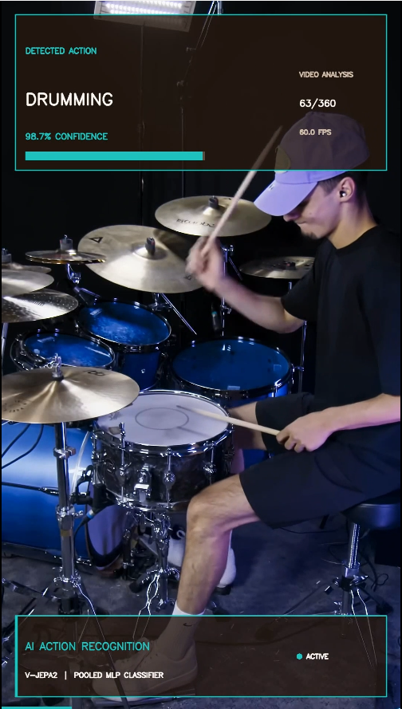

# V-JEPA2 Activity Recognition

A command-line deployment pipeline for recognizing one of the 101 UCF-101 action classes in a video or live camera stream. It uses the same inference design as the notebook: sample a 32-frame clip, run the `facebook/vjepa2-vitl-fpc64-256` video backbone, average-pool its patch features, and classify them with the notebook's pooled MLP. Predictions are drawn over the video with the notebook's dark navy, teal-accented dashboard.

## Example output

Surfing clip with the action label and confidence overlay:

</video>

[Open or download the video](outputs/drumming_final.mp4.mp4).


## Install

```bash
python -m venv .venv
# Windows PowerShell:
.venv\Scripts\Activate.ps1
# macOS/Linux:
# source .venv/bin/activate
python -m pip install --upgrade pip
pip install -r requirements.txt
```

Install a PyTorch build that matches your CUDA setup if using an NVIDIA GPU; the default PyPI install may be CPU-only. CPU inference is supported, but V-JEPA2 is large and will run much more slowly. The first run downloads the backbone and video processor from Hugging Face. Ensure the model files are accessible and that you have accepted any Hugging Face access terms that apply.

## Run on a video

```bash
python -m vjepa_activity --video path/to/input.mp4
```

The default output is `path/to/input_annotated.mp4`. Choose an explicit output path or display the annotated video as it is processed:

```bash
python -m vjepa_activity --video path/to/input.mp4 --output outputs/result.mp4 --display
```

Video input runs to completion. Press **Q** to close the optional preview window early. The annotated MP4 is written without audio.

## Run on a camera

```bash
python -m vjepa_activity --camera
```

Use a different camera device index and output filename when needed:

```bash
python -m vjepa_activity --camera 1 --output outputs/camera.mp4
```

Press **Q** in the camera window to stop. The annotated camera recording is saved as an MP4.

## Options

- `--checkpoint`: classifier checkpoint path (default `checkpoints/classifier.pt`)
- `--backbone`: Hugging Face backbone identifier (default `facebook/vjepa2-vitl-fpc64-256`)
- `--device`: `auto`, `cpu`, `cuda`, or a device such as `cuda:0` (default `auto`)
- `--window`: frames per prediction (default `32`, matching notebook feature extraction)
- `--output`: annotated output video path
- `--display`: show an additional preview window for file input

Predictions update once per 32-frame window and are shown on subsequent frames until the next window is classified. Short clips initially display “Collecting frames.” Camera capture and file inference share the same feature extraction and classifier path.

## Project layout

```text
src/vjepa_activity/
  classifier.py   # Notebook-compatible pooled MLP
  cli.py          # Argument parsing and video/camera pipelines
  model.py        # Checkpoint, processor, and backbone loading
  overlay.py      # Notebook dashboard overlay
  __main__.py     # python -m entry point
```

The notebook used for model training and the rendered sample videos are in `notebook/` and `outputs/`.
